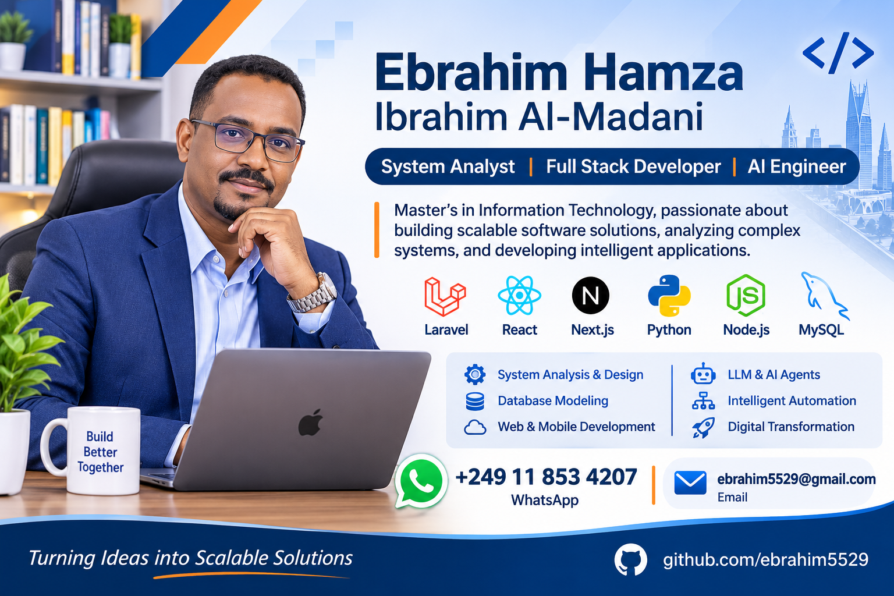

  

# Hi, I'm Ebrahim Hamza 👋

### System Analyst | Full Stack Developer | AI Engineer

Master's in Information Technology, passionate about building scalable software solutions, analyzing complex systems, and developing intelligent applications.

I specialize in transforming business requirements into well-structured systems, robust databases, and practical software products.

## About Me

- System Analysis and Software Architecture
- Full Stack Web Development
- Database Design and Modeling
- Large Language Models (LLMs)
- AI Agents and Intelligent Automation
- Researching Domain-Specific AI Models

## Technical Skills

**Backend:** PHP, Laravel, Node.js, NestJS

**Frontend:** JavaScript, TypeScript, React, Next.js, HTML, CSS, Bootstrap, Tailwind CSS

**Database:** MySQL, PostgreSQL, SQLite

**AI & Automation:** Python, LangChain, LangGraph, LLMs, RAG, n8n

**Tools:** Git, GitHub, Docker, Cursor

## Professional Interests

- AI-powered Software Engineering
- Intelligent Business Automation
- System Analysis and Database Modeling
- Building Scalable SaaS Applications

## Connect With Me

- GitHub: [@ebrahim5529](https://github.com/ebrahim5529)
- Email: ebrahim5529@gmail.com
- whatsapp : https://wa.me/249118534207
